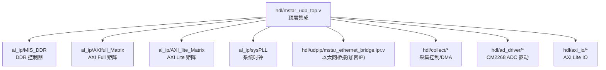
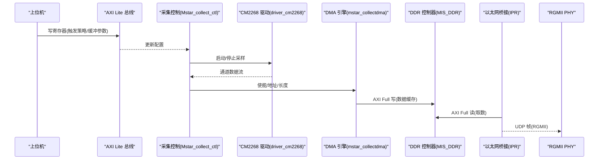
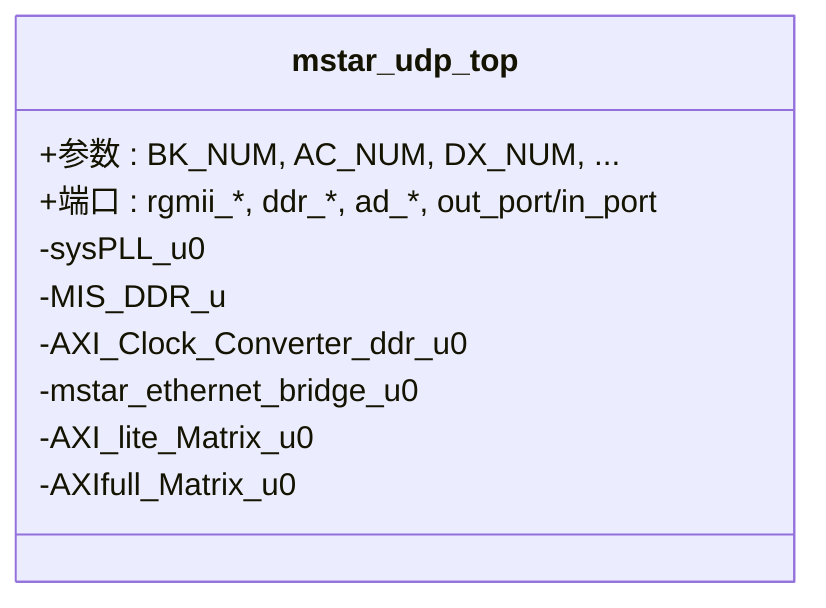
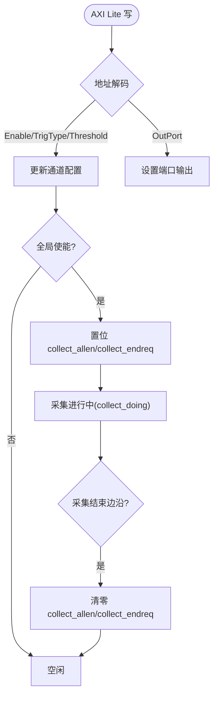
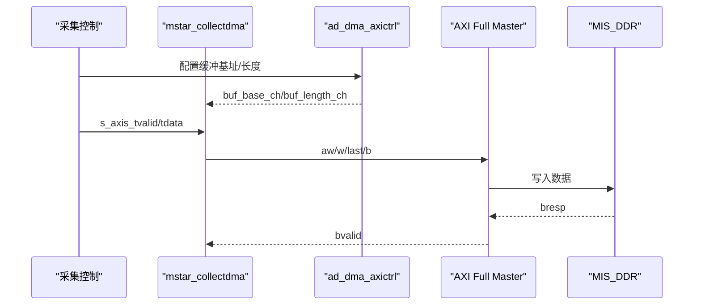
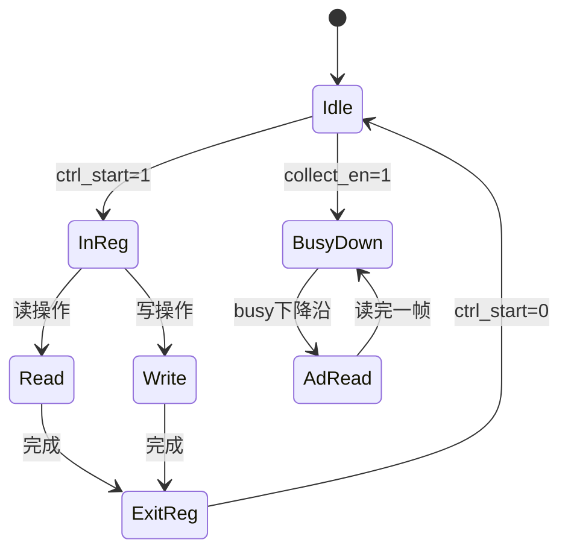
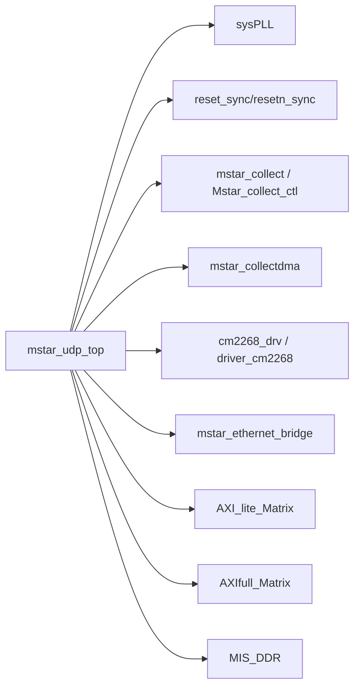

# 多通道采集控制增强

<cite>
**本文引用的文件**   
- [README.md](file://README.md)
- [tand_udp.al](file://tand_udp.al)
- [mstar_udp_top.v](file://hdl/mstar_udp_top.v)
- [mstar_collect.v](file://hdl/collect/mstar_collect.v)
- [Mstar_collect_ctl.v](file://hdl/collect/Mstar_collect_ctl.v)
- [mstar_collectdma.v](file://hdl/collect/mstar_collectdma.v)
- [cm2268_drv.v](file://hdl/ad_driver/cm2268_drv.v)
- [driver_cm2268.v](file://hdl/ad_driver/driver_cm2268.v)
- [mstar_axilite_io.v](file://hdl/axi_io/mstar_axilite_io.v)
- [axi_dma_example_axi_write_master.sv](file://hdl/axi_dma/axi_dma_example_axi_write_master.sv)
- [axi_dma_example_axi_read_master.sv](file://hdl/axi_dma/axi_dma_example_axi_read_master.sv)
</cite>

## 目录
1. [引言](#引言)
2. [项目结构](#项目结构)
3. [核心组件](#核心组件)
4. [架构总览](#架构总览)
5. [详细组件分析](#详细组件分析)
6. [依赖关系分析](#依赖关系分析)
7. [性能与优化建议](#性能与优化建议)
8. [故障排查指南](#故障排查指南)
9. [结论](#结论)

## 引言
本项目面向多通道 AD 数据采集场景，基于安路 PH1 FPGA，实现“ADC 驱动 → 多通道采集控制 → DMA 写入 DDR → AXI Full 总线 → UDP/IP 以太网传输”的完整链路。系统通过 AXI Lite 寄存器接口完成参数配置，支持外部触发、通道级触发策略、缓冲区长度与相对位置管理，并通过加密 IP 桥接以太网 MAC/UDP/IP 协议栈，最终经 RGMII 输出至上位机。

## 项目结构
工程采用分层组织：
- hdl：用户逻辑（顶层、采集、AD 驱动、AXI IO、DMA 示例、约束）
- al_ip：安路 IP（DDR、矩阵互联、时钟转换、FIFO、PLL 等）
- 配置文件：Tang Dynasty 工程描述与器件配置

图表来源
- [mstar_udp_top.v:371-483](file://hdl/mstar_udp_top.v#L371-L483)
- [mstar_udp_top.v:591-675](file://hdl/mstar_udp_top.v#L591-L675)
- [mstar_udp_top.v:676-800](file://hdl/mstar_udp_top.v#L676-L800)

章节来源
- [README.md:23-73](file://README.md#L23-L73)
- [tand_udp.al:15-234](file://tand_udp.al#L15-L234)

## 核心组件
- 顶层 mstar_udp_top：时钟域生成与复位同步、DDR 控制器实例化、AXI 矩阵互联、以太网桥接 IP 接入、外设 I/O 与 LED 指示。
- 采集子系统 mstar_collect + Mstar_collect_ctl：多通道触发策略、采集使能、结束标志、端口映射与状态上报。
- DMA 引擎 mstar_collectdma + onedmafifo_con + ad_dma_axictrl：将采集数据经 AXI Full 写入 DDR，并暴露缓冲基址/长度给上层。
- ADC 驱动 cm2268_drv + driver_cm2268：CM2268 时序控制、寄存器读写、采样数据打包与输出。
- AXI Lite IO mstar_axilite_io：通用寄存器 IO，提供 LED/IO 控制与触发开关。
- 以太网桥接 mstar_ethernet_bridge：MAC/UDP/IP 协议栈与 AXI 接口封装（加密 IP）。

章节来源
- [mstar_udp_top.v:9-92](file://hdl/mstar_udp_top.v#L9-L92)
- [mstar_collect.v:9-62](file://hdl/collect/mstar_collect.v#L9-L62)
- [Mstar_collect_ctl.v:22-68](file://hdl/collect/Mstar_collect_ctl.v#L22-L68)
- [mstar_collectdma.v:9-66](file://hdl/collect/mstar_collectdma.v#L9-L66)
- [cm2268_drv.v:9-51](file://hdl/ad_driver/cm2268_drv.v#L9-L51)
- [driver_cm2268.v:9-39](file://hdl/ad_driver/driver_cm2268.v#L9-L39)
- [mstar_axilite_io.v:22-55](file://hdl/axi_io/mstar_axilite_io.v#L22-L55)

## 架构总览
系统数据与控制流如下：
- 控制面：上位机通过 AXI Lite 访问各子模块寄存器，配置 ADC 采样参数、触发策略、DMA 缓冲地址/长度、端口输出等。
- 数据面：ADC 数据经驱动打包后进入采集控制，按通道与触发条件产生有效数据流；DMA 引擎将数据写入 DDR；以太网桥接从 AXI Full 读取数据并封装为 UDP 包经 RGMII 发送。

图表来源
- [mstar_udp_top.v:591-675](file://hdl/mstar_udp_top.v#L591-L675)
- [mstar_udp_top.v:415-483](file://hdl/mstar_udp_top.v#L415-L483)
- [mstar_collectdma.v:77-110](file://hdl/collect/mstar_collectdma.v#L77-L110)
- [driver_cm2268.v:103-152](file://hdl/ad_driver/driver_cm2268.v#L103-L152)

## 详细组件分析

### 顶层 mstar_udp_top
- 时钟与复位：sysPLL 产生 125M/100M/50M，reset_sync/resetn_sync 做跨时钟域复位同步。
- DDR 路径：AXI_Clock_Converter_ddr 在 100M 与 DDR 时钟之间进行 AXI 时钟域转换，连接 MIS_DDR。
- 以太网路径：mstar_ethernet_bridge 提供 AXI Lite 与 AXI Full 接口，直连 RGMII。
- 总线矩阵：AXI_lite_Matrix 与 AXIfull_Matrix 分别对 AXI Lite/Full 进行路由与扇出。

图表来源
- [mstar_udp_top.v:371-483](file://hdl/mstar_udp_top.v#L371-L483)
- [mstar_udp_top.v:484-569](file://hdl/mstar_udp_top.v#L484-L569)
- [mstar_udp_top.v:591-675](file://hdl/mstar_udp_top.v#L591-L675)
- [mstar_udp_top.v:676-800](file://hdl/mstar_udp_top.v#L676-L800)

章节来源
- [mstar_udp_top.v:9-92](file://hdl/mstar_udp_top.v#L9-L92)
- [mstar_udp_top.v:371-483](file://hdl/mstar_udp_top.v#L371-L483)
- [mstar_udp_top.v:484-569](file://hdl/mstar_udp_top.v#L484-L569)
- [mstar_udp_top.v:591-675](file://hdl/mstar_udp_top.v#L591-L675)
- [mstar_udp_top.v:676-800](file://hdl/mstar_udp_top.v#L676-L800)

### 多通道采集控制 mstar_collect 与 Mstar_collect_ctl
- mstar_collect：聚合各通道触发器 triggel，汇总 collect_end、out_trigflg，并将 AXI Lite 配置下发到 Mstar_collect_ctl。
- Mstar_collect_ctl：实现 AXI Lite 读写 FSM，维护通道使能、触发类型/阈值、相对位置、端口 IO 与状态位；根据 collect_end 边沿复位采集全局使能与结束请求。

图表来源
- [Mstar_collect_ctl.v:103-162](file://hdl/collect/Mstar_collect_ctl.v#L103-L162)
- [Mstar_collect_ctl.v:207-259](file://hdl/collect/Mstar_collect_ctl.v#L207-L259)
- [mstar_collect.v:86-106](file://hdl/collect/mstar_collect.v#L86-L106)

章节来源
- [mstar_collect.v:9-62](file://hdl/collect/mstar_collect.v#L9-L62)
- [mstar_collect.v:107-188](file://hdl/collect/mstar_collect.v#L107-L188)
- [Mstar_collect_ctl.v:22-68](file://hdl/collect/Mstar_collect_ctl.v#L22-L68)
- [Mstar_collect_ctl.v:103-162](file://hdl/collect/Mstar_collect_ctl.v#L103-L162)
- [Mstar_collect_ctl.v:207-259](file://hdl/collect/Mstar_collect_ctl.v#L207-L259)

### DMA 引擎 mstar_collectdma
- 功能：接收采集数据流(s_axis_tvalid/tdata)，依据 ad_dma_axictrl 提供的缓冲基址/长度，通过 AXI Full Master 写入 DDR。
- 关键信号：buf_base_ch/buf_length_ch 由 AXI Lite 配置；buflen/pre_buflen 用于上层统计；DMA_oksta 表示 DMA 就绪。

图表来源
- [mstar_collectdma.v:77-110](file://hdl/collect/mstar_collectdma.v#L77-L110)
- [mstar_collectdma.v:111-148](file://hdl/collect/mstar_collectdma.v#L111-L148)

章节来源
- [mstar_collectdma.v:9-66](file://hdl/collect/mstar_collectdma.v#L9-L66)
- [mstar_collectdma.v:77-148](file://hdl/collect/mstar_collectdma.v#L77-L148)

### ADC 驱动 cm2268_drv 与 driver_cm2268
- cm2268_drv：封装 AXI Lite 寄存器访问与底层时序控制，输出 128bit 打包数据与使能。
- driver_cm2268：实现寄存器模式与采样模式的切换，处理 busy 下降沿、连续读取 8 个通道数据，并按需分频控制转换速率。

图表来源
- [driver_cm2268.v:103-152](file://hdl/ad_driver/driver_cm2268.v#L103-L152)
- [driver_cm2268.v:155-269](file://hdl/ad_driver/driver_cm2268.v#L155-L269)
- [cm2268_drv.v:70-138](file://hdl/ad_driver/cm2268_drv.v#L70-L138)

章节来源
- [cm2268_drv.v:9-51](file://hdl/ad_driver/cm2268_drv.v#L9-L51)
- [cm2268_drv.v:70-138](file://hdl/ad_driver/cm2268_drv.v#L70-L138)
- [driver_cm2268.v:9-39](file://hdl/ad_driver/driver_cm2268.v#L9-L39)
- [driver_cm2268.v:103-152](file://hdl/ad_driver/driver_cm2268.v#L103-L152)
- [driver_cm2268.v:155-269](file://hdl/ad_driver/driver_cm2268.v#L155-L269)

### AXI Lite IO mstar_axilite_io
- 提供模型 ID、系统控制位（trigout_en/trigin_en）、输出寄存器、输入寄存器读写。
- 内部使用标准 AXI Lite FSM，保证握手时序正确。

章节来源
- [mstar_axilite_io.v:22-55](file://hdl/axi_io/mstar_axilite_io.v#L22-L55)
- [mstar_axilite_io.v:65-164](file://hdl/axi_io/mstar_axilite_io.v#L65-L164)
- [mstar_axilite_io.v:166-192](file://hdl/axi_io/mstar_axilite_io.v#L166-L192)

### 以太网桥接与 AXI Full 数据通路
- mstar_ethernet_bridge：提供 AXI Lite 配置与 AXI Full 数据接口，内部包含 MAC/UDP/IP 协议栈（加密 IP），对外 RGMII。
- AXI Full 矩阵：将 UDP 数据通路接入以太网桥接。

章节来源
- [mstar_udp_top.v:591-675](file://hdl/mstar_udp_top.v#L591-L675)
- [mstar_udp_top.v:763-800](file://hdl/mstar_udp_top.v#L763-L800)

## 依赖关系分析
- 顶层依赖 sysPLL、reset_sync、resetn_sync 提供稳定时钟与复位。
- 采集控制依赖 AXI Lite 总线与 triggel 通道逻辑。
- DMA 依赖 ad_dma_axictrl 提供的缓冲参数与 onedmafifo_con 的数据适配。
- ADC 驱动依赖 AXI Lite 与 CM2268 硬件时序。
- 以太网桥接依赖 AXI Full 与 RGMII PHY。

图表来源
- [mstar_udp_top.v:371-483](file://hdl/mstar_udp_top.v#L371-L483)
- [mstar_udp_top.v:591-675](file://hdl/mstar_udp_top.v#L591-L675)
- [mstar_udp_top.v:676-800](file://hdl/mstar_udp_top.v#L676-L800)

章节来源
- [tand_udp.al:15-234](file://tand_udp.al#L15-L234)

## 性能与优化建议
- 时钟与复位：确保 sysPLL 锁定后再释放各域复位，避免亚稳态；已在顶层使用 reset_sync/resetn_sync。
- AXI 宽度匹配：采集数据宽度与 DMA 数据宽度一致（128bit），减少跨层转换开销。
- 突发长度：AXI Full 写突发长度合理设置，提升带宽利用率。
- 触发策略：优先使用上升沿触发，降低误触发概率；外部触发需加边沿检测与去抖。
- 缓冲区管理：预触发长度与结束相对位置应结合应用需求调整，避免覆盖或丢数据。
- 网络吞吐：UDP 包大小与 MTU 匹配，避免分片；必要时调整以太网桥接内部 FIFO 深度。

[本节为通用指导，不直接分析具体文件]

## 故障排查指南
- 无数据输出：
  - 检查 ADC 驱动是否进入采样模式（modeflg），busy 下降沿是否被捕获。
  - 确认采集控制 collect_allen/collect_endreq 是否正确置位。
  - 验证 DMA 缓冲基址/长度是否配置正确，AXI Full 握手是否正常。
- 触发异常：
  - 检查 triggel 通道配置（trigtype/trigdat）与外部触发边沿检测。
  - 观察 out_trigflg 与 in_trigflg 的状态变化。
- 以太网不通：
  - 查看 link_error 与 speed_status 指示灯，确认 PHY 链路状态。
  - 检查 AXI Full 读通路是否被矩阵正确路由至以太网桥接。
- 寄存器读写失败：
  - 核对 AXI Lite FSM 状态机是否处于 RDIDLE/RDDATA 或 WRIDLE/WRDATA。
  - 检查地址解码与数据掩码（WSTRB）是否正确。

章节来源
- [driver_cm2268.v:103-152](file://hdl/ad_driver/driver_cm2268.v#L103-L152)
- [Mstar_collect_ctl.v:103-162](file://hdl/collect/Mstar_collect_ctl.v#L103-L162)
- [mstar_collectdma.v:77-148](file://hdl/collect/mstar_collectdma.v#L77-L148)
- [mstar_udp_top.v:591-675](file://hdl/mstar_udp_top.v#L591-L675)

## 结论
本方案以清晰的层次划分实现了多通道 AD 采集、触发控制、DMA 缓存与以太网传输的全链路功能。通过 AXI Lite 统一配置、AXI Full 高效数据搬运与加密 IP 简化协议栈集成，系统在稳定性与可扩展性上具备良好基础。后续可围绕触发精度、缓冲区策略与网络吞吐进行针对性优化，以满足更高带宽与更低时延的应用需求。